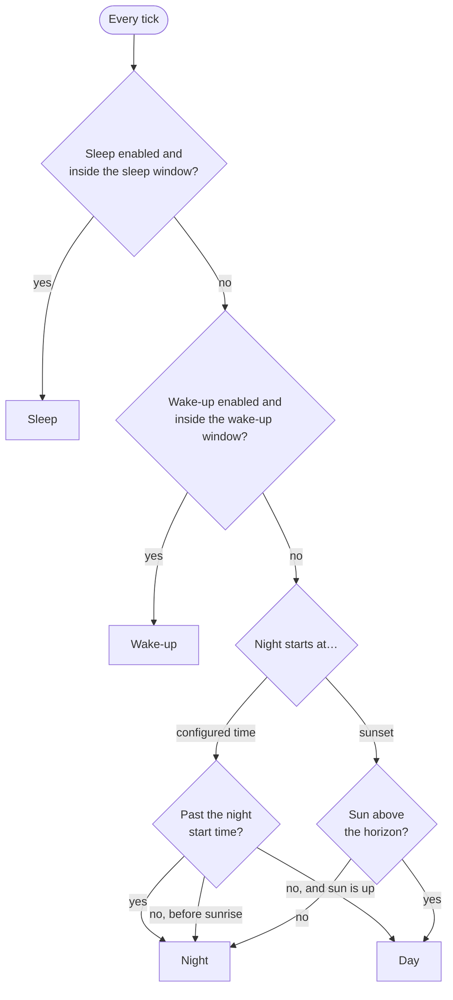
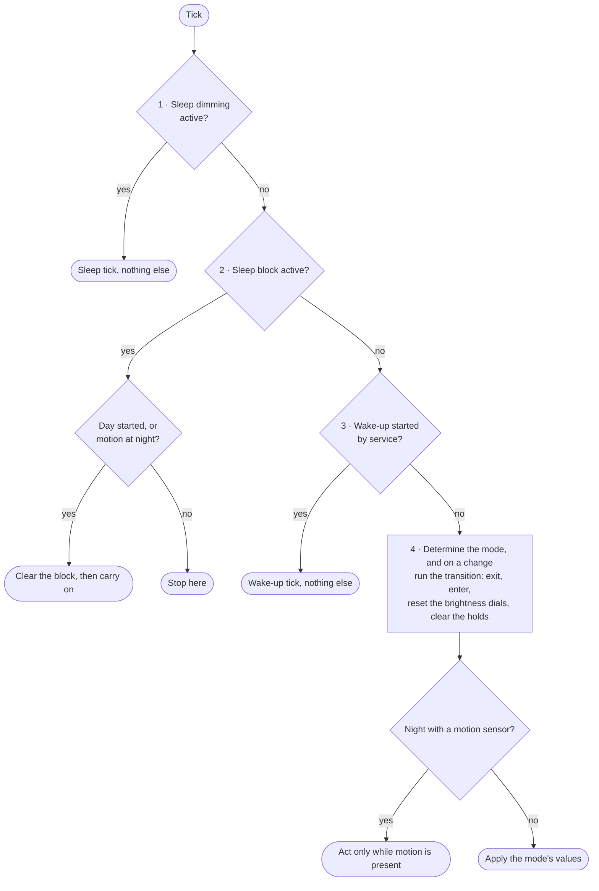
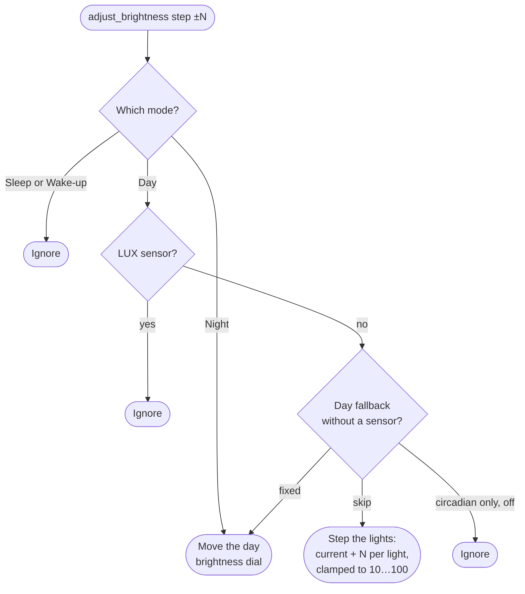
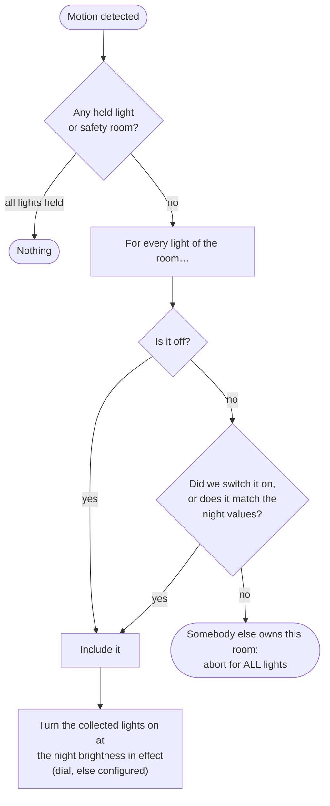
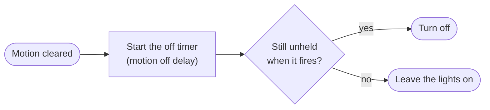

# How a decision is made

Four modes, per-light holds, a wall button and a control loop — the pieces are
each simple, but the question "why did my light just do that?" needs the whole
picture. This document is that picture.

- [Which mode is running](#which-mode-is-running)
- [What the tick does](#what-the-tick-does)
- [Who may touch the lights](#who-may-touch-the-lights)
- [A button press](#a-button-press)
- [The life of a hold](#the-life-of-a-hold)
- [Night mode and motion](#night-mode-and-motion)

## Which mode is running

The mode comes purely from the clock and the sun; no light state and no
sensor reading is involved. Sleep and wake-up win over day and night, so a
ramp is never interrupted by the schedule underneath it.



## What the tick does

The tick runs once a minute and whenever a light or the LUX sensor changes.
The service-started states outrank the schedule first, then the mode is
determined and its values are applied.



External control is no longer checked on the tick. Detection is event-driven:
a light that reports values we did not command is held the moment it reports
them, not on the next minute.

## Who may touch the lights

Two things stop the integration from touching a light, and they stop it at
different granularity.

| Thing | What it stops |
|---|---|
| Main switch off | everything, in every mode |
| A held light | that one light, in every mode |
| Sleep block | all light control, until day starts or motion is present |

A **hold** is per-light, not per-room. Each light is held for one of two
reasons, both visible on the `on_hold` binary sensor:

- **`detected`** — somebody outside the integration changed the light. The
  integration steps back from *that light* and leaves it alone.
- **`service`** — your automation called `turn_on`/`turn_off` with
  `hold: true`, or `hold_all`.

A hold never cancels a mode or a ramp. A sleep or wake-up ramp keeps running
for the non-held lights; it simply skips the held ones. Entering a new mode
clears every hold, so a visitor's choice lives only within the phase it was
made in.

The **safety room** (the *Block wall buttons* switch, only meaningful in a
motion-lit room at night) is the one exception: while it is on, the
integration ignores wall-button services *and* re-applies the configured
defaults even to held lights.

## A button press

`adjust_brightness` is meant for a wall button, and a button press is an
event without state. A hold is a state. Turning one into the other is what
makes wall buttons behave badly, so a press never sets a hold — it is our own
doing, not an intervention to step aside for. One rule decides what happens
instead:

> A step is **applied to the lights** where nothing here controls their
> brightness, it **moves the target** where we aim at a fixed value, and it
> is **ignored** where neither is possible.



The reasoning behind each branch:

| Branch | Why |
|---|---|
| Night | Open loop on a value nothing else fights over, so the target can simply move. Motion, colour and the off timer keep running. |
| Day with LUX | The brightness is a closed loop against the LUX reading, so a step would be regulated away within a tick or two — there is no value to hold. The press is ignored. |
| Day, no LUX, fallback skip | Day mode sets no brightness at all here, so the step stands. |
| Day, no LUX, fallback circadian only | Day mode controls colour only here; a brightness step is ignored. |
| Day, no LUX, fallback fixed | Day mode re-sends its fixed value every tick, so the press moves the day brightness dial. |
| Day, no LUX, fallback off | Day mode wants these lights off; a step would be undone at the next tick. |
| Sleep, Wake-up | Their ramps recompute start and end on every tick, so a step would be overwritten seconds later. |

The day brightness dial resets when day mode starts, the same way the night
dial resets when night mode starts, and a new configuration drops both. A
step acts on the brightness in effect, so a press at 100 % or at the floor
piles up nothing that the presses back would first have to wear off. A press
that acts also releases the hold a `turn_on`/`turn_off` placed, so you can
dim again right after switching the lights off.

Three details that matter in practice. The target is computed per light
instead of using Home Assistant's `brightness_step_pct`, because that walks
past zero and switches a light off — a dark staircase is worse than a bright
one. An already dark light stays dark when dimming; only brightening switches
one on. And a step goes through the same applier every mode handler uses, so
the values are recorded as ours; sending them any other way would have the
detection read our own press back as an outside intervention.

## The life of a hold

A hold means one thing: **this light must be left alone.** How it is released
depends on why it was set.

```mermaid
flowchart TD
    subgraph set [How it is set]
        d["Detection: a light reports<br/>values we did not command"] --> detected[detected]
        s["turn_on / turn_off with<br/>hold: true, or hold_all"] --> service[service]
    end
    detected --> life[The light is excluded<br/>from every handler]
    service --> life
    life --> end{How does it end?}
    end -- "release_hold (service, button)" --> release
    end -- "the next mode transition" --> release
    release["Release: clear the holds,<br/>reset the dials, forget the applied values,<br/>apply the mode now"]
```

Three things about this are deliberate.

A **detected** hold has no timeout and no stability take-over. It ends only
when you release it or the mode changes, because a scene somebody froze is
theirs until the phase moves on. The hold is persisted with the switch, so a
restart or an options change does not end it.

A **service** hold is the deliberate, bounded version of "hands off": it ends
when your automation says so (`release_hold`) or on the next mode transition.
That is the replacement for the old "manual control" switch — `hold_all`
holds every light of the instance at once.

"Apply the mode now" means exactly what the next tick would apply. Inside a
sleep or wake-up ramp that is the ramp, and in the dark block after a sleep
it is nothing at all. A release never flashes day or night values into a
ramp for a minute.

Forgetting the applied values is part of every release. Day mode only sends a
brightness when it differs from the last one *it* sent, and after somebody
else has been at the lights that reference describes nothing real. Without
forgetting, a room can stay at a stranger's brightness indefinitely: on a
bright day the LUX-derived target barely moves, so every tick decides it is
already there. The flapping freeze is *not* cleared — a room that was
oscillating is still oscillating.

## Night mode and motion

Night mode is the one mode that is not driven by the tick. With a motion
sensor configured, motion owns the lights and the tick only watches.



When motion clears, nothing happens immediately — the off timer decides, and
it checks the holds again when it fires:



Note that a single foreign light aborts the turn-on for the whole room. That
is intended — a room is lit as a unit — but it makes the comparison against
the night values load-bearing: it reads the *brightness in effect*, dial
included, so a dimmed room does not look foreign to itself.

That single access point is what makes the dial work everywhere: the motion
turn-on, the expected state used for detection, and the off-timer guard all
read the same value.
